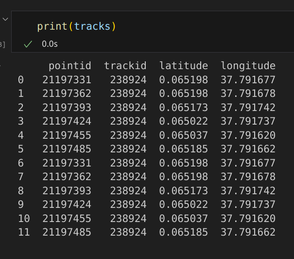
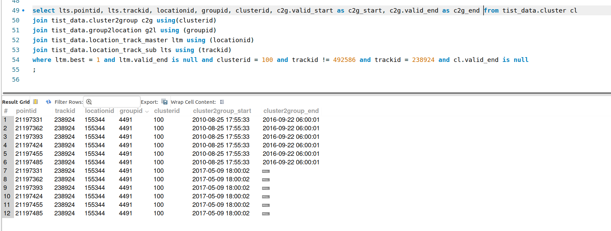

# Exceptions/Edge Cases Encountered

## One location+track referenced multiple times
There should be 6 points with unique pointid but these are duplicated (forming 12). This results in an invalid polygon.

In this specific case, cluster2group has two entries for the same group.

